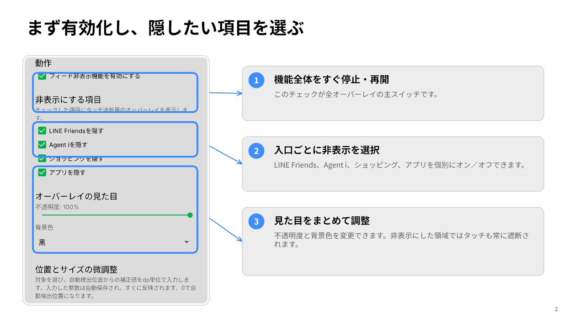
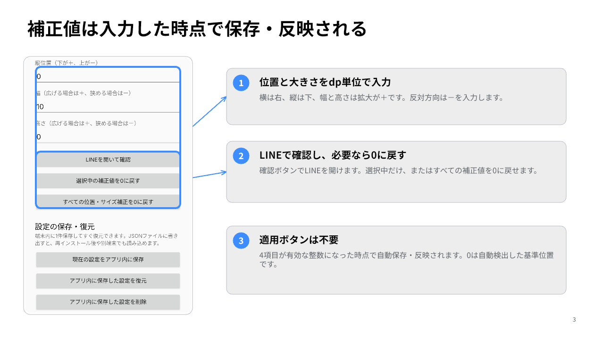
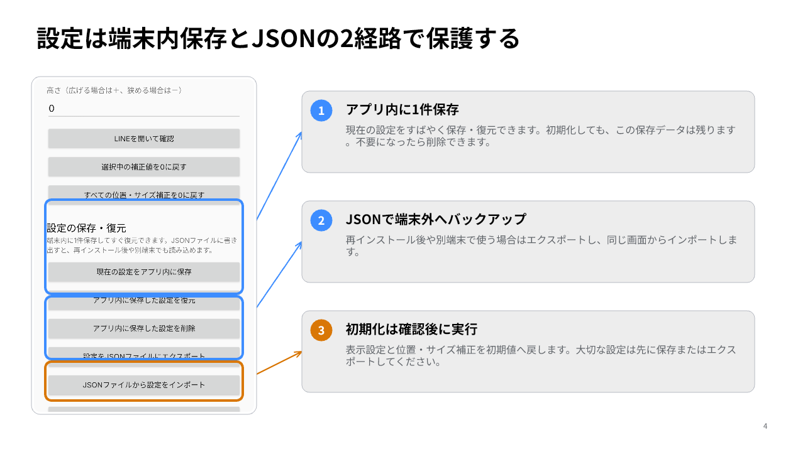

# LINE Feed Blocker

Android版LINEのホームフィードや指定した入口を、アクセシビリティオーバーレイで隠す個人端末向けアプリです。隠した領域へのタッチも遮断します。LINEのAPK改変、Root化、通信内容の取得は行いません。

## できること

- ホーム画面の中央コンテンツ領域を隠す
- LINE Friends、Agent i、ショッピング、アプリを個別に隠す
- トーク一覧に広告・ニュース枠がある場合、その領域を隠す
- オーバーレイの不透明度と背景色を変更する
- 各オーバーレイの位置と大きさを数値で微調整する
- 設定をアプリ内またはJSONファイルへ保存し、復元する



## 使い始める

1. デバッグAPKを端末へインストールします。
2. アプリの「ユーザー補助設定を開く」から、LINE Feed Blockerを有効にします。
3. 「フィード非表示機能を有効にする」をオンにします。
4. 「非表示にする項目」で必要な項目を選びます。
5. LINEを開き、表示位置を確認します。

詳しい操作は [利用ガイド](docs/USER_GUIDE.md) を参照してください。注釈を後から修正・再利用できる [編集用PowerPoint](docs/assets/line-feed-blocker-operation-guide.pptx) もあります。

## 位置とサイズを微調整する

「位置とサイズの微調整」で対象を1つ選び、次の補正値をdp単位の整数で入力します。

| 項目 | 正の値 | 負の値 |
| --- | --- | --- |
| 横位置 | 右へ移動 | 左へ移動 |
| 縦位置 | 下へ移動 | 上へ移動 |
| 幅 | 広げる | 狭める |
| 高さ | 広げる | 狭める |

4項目が有効な整数になると、設定は自動保存され、すぐに反映されます。適用ボタンはありません。`0`に戻すと自動検出した基準位置になります。



## 設定を保護する

- アプリ内保存: 現在の設定を端末内に1件保存し、すぐ復元できます。
- JSONエクスポート: 再インストールや別端末への移行に使います。
- 初期化: 現在の表示設定と補正値を初期値に戻します。アプリ内に保存した1件は削除されません。



## プライバシーと制約

- ネットワーク権限は要求しません。
- UI調査ログは、デバッグオプションとログ取得を明示的に有効にした場合だけ端末内のlogcatへ出力します。
- 調査ログには投稿やメッセージの文字列が含まれる場合があります。通常はオフのまま使用してください。
- LINEのUI変更後は自動検出が合わなくなる可能性があります。判定できない場合、オーバーレイは表示しません。
- 2026-07-20時点でLINE 26.10.1を使って実機確認しています。

## ビルドとインストール

JDK 17とAndroid SDKを用意し、Windows PowerShellで実行します。

```powershell
$env:JAVA_HOME = 'C:\Program Files\Eclipse Adoptium\jdk-17.0.19.10-hotspot'
$env:ANDROID_HOME = 'C:\Android\Sdk'
$env:Path = "$env:ANDROID_HOME\platform-tools;$env:ANDROID_HOME\cmdline-tools\latest\bin;$env:Path"
.\gradlew.bat assembleDebug
adb install -r app\build\outputs\apk\debug\app-debug.apk
```

現在の実装要件と判定ルールは [仕様書](SPEC.md) を参照してください。
