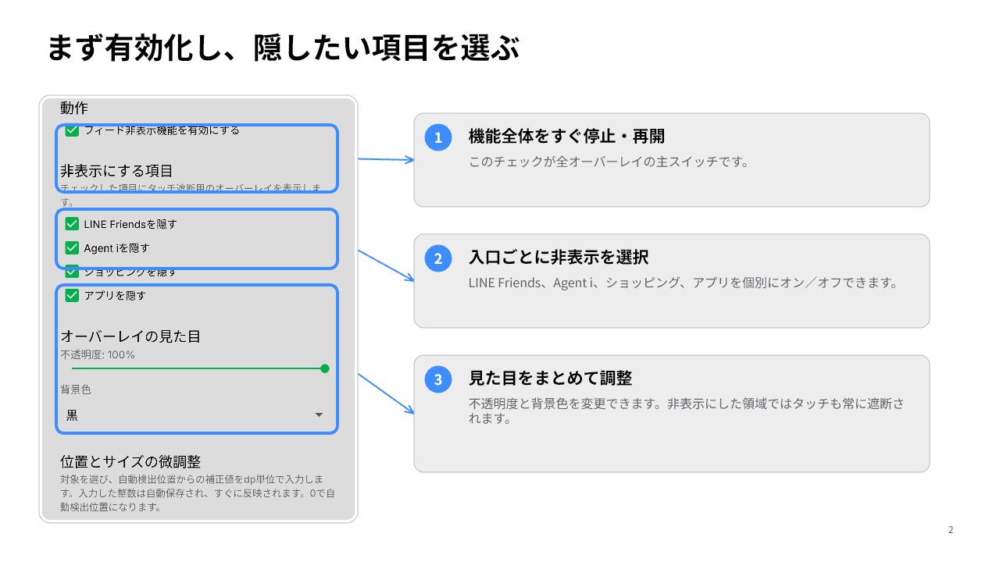
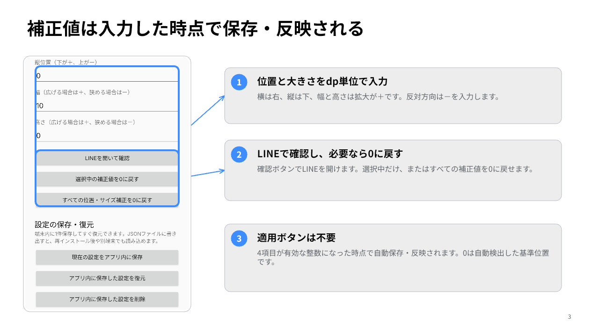
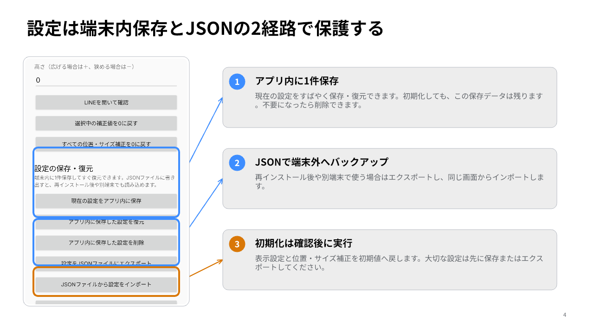
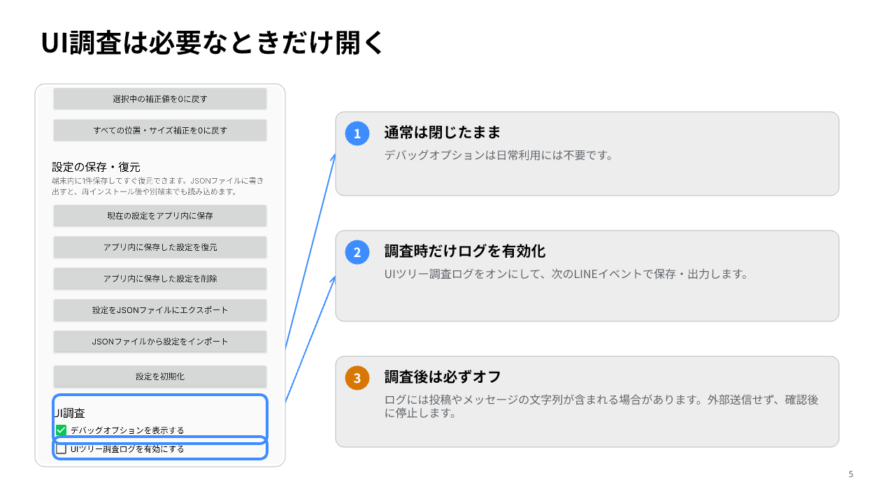

# LINE Feed Blocker 利用ガイド

このガイドでは、初期設定、非表示対象の選択、位置とサイズの微調整、設定のバックアップを説明します。掲載画像の注釈は、[編集用PowerPoint](assets/line-feed-blocker-operation-guide.pptx) で修正・再利用できます。

## 1. 初期設定

1. LINE Feed Blockerを開きます。
2. 「ユーザー補助設定を開く」を押します。
3. Androidの設定画面でLINE Feed Blockerを選び、サービスを有効にします。
4. アプリへ戻り、上部の状態が「ユーザー補助サービス: 有効」になったことを確認します。
5. 「フィード非表示機能を有効にする」をオンにします。

アクセシビリティサービスを無効にすると、LINE上のオーバーレイはすべて停止します。

## 2. 隠す項目と見た目を選ぶ

「非表示にする項目」では、LINE Friends、Agent i、ショッピング、アプリを個別に選べます。チェックした項目は見えなくなり、同じ領域へのタッチも遮断されます。タッチ遮断だけを解除する設定はありません。

「LINE内ブラウザをブロックする」は初期状態でオンです。LINE内でリンクを開くとブロック画面が表示されます。Androidの「戻る」で前の画面に戻れます。

「オーバーレイの見た目」では、不透明度と背景色を変更できます。LINEの画面を見ながら、必要な見え方に調整してください。

## 3. 位置とサイズを微調整する

端末やLINEの更新によってオーバーレイがずれた場合だけ調整します。

1. 「調整するオーバーレイ」で対象を1つ選びます。
2. 横位置、縦位置、幅、高さへdp単位の整数を入力します。
3. 4項目が有効な整数になると、自動で保存・反映されます。
4. 「LINEを開いて確認」で対象画面を確認します。
5. 元に戻す場合は「選択中の補正値を0に戻す」を押します。

| 入力欄 | `+`の効果 | `-`の効果 |
| --- | --- | --- |
| 横位置 | 右へ移動 | 左へ移動 |
| 縦位置 | 下へ移動 | 上へ移動 |
| 幅 | 左右に広げる | 左右を狭める |
| 高さ | 上下に広げる | 上下を狭める |

入力できる範囲は各項目`-1000`から`1000`です。入力途中で空欄になっている間は直前の設定を維持し、4項目が有効になった時点で更新します。`0`は自動検出した基準位置です。

調整対象は、ホームフィード、ショッピング／アプリ画面全体、LINE Friends、Agent i、ショッピングのタブアイコン、アプリのタブアイコン、トーク広告です。

## 4. 設定を保存・復元する

### すぐ戻せる状態を端末内に保存する

「現在の設定をアプリ内に保存」を押すと、設定一式を1件保存します。「アプリ内に保存した設定を復元」で戻せます。新しく保存すると前の保存内容を置き換えます。

現在の設定を初期化しても、アプリ内に保存した設定は残ります。不要になった場合は「アプリ内に保存した設定を削除」を押します。

### 再インストールや端末変更に備える

1. 「設定をJSONファイルにエクスポート」を押します。
2. Androidのファイル選択画面で保存先を選びます。
3. 復元時は「JSONファイルから設定をインポート」を押し、保存したファイルを選びます。
4. LINEを開き、表示状態を確認します。

JSONファイルにはアプリの設定だけが入り、LINEのメッセージや投稿は入りません。

### 現在の設定を初期化する

「設定を初期化」を押し、確認ダイアログで実行します。個別の非表示設定、見た目、位置とサイズの補正が初期値に戻ります。重要な設定は先にアプリ内保存またはJSONエクスポートしてください。

## 5. UI調査を行う

UI調査は、LINE更新後に自動検出が合わなくなった場合など、開発・調査時だけ使います。

1. 「デバッグオプションを表示する」をオンにします。
2. 「UIツリー調査ログを有効にする」をオンにします。
3. 「次のLINEイベントでUIツリーを保存・出力」を押します。
4. LINEで調べたい画面を開くか、少しスクロールします。
5. PCで `adb logcat -s LineFeedInspector` を確認します。
6. 調査後は「UIツリー調査ログを有効にする」をオフにします。

ログには投稿やメッセージの文字列が含まれる場合があります。外部へ共有する前に内容を確認してください。通常利用ではデバッグオプションを閉じたままにします。

## 6. 困ったとき

### 何も隠れない

- アプリ上部でユーザー補助サービスが「有効」か確認します。
- 「フィード非表示機能を有効にする」がオンか確認します。
- 個別項目のチェックを確認します。
- LINEから別アプリへ移動して戻り、再判定させます。

### 位置がずれている

- 対象を1つ選び、補正値を少量ずつ変更します。
- `+10`または`-10`程度から試し、LINEで結果を確認します。
- 原因が分からない場合は選択中の補正値を`0`に戻します。

### LINE更新後に誤動作する

まず機能全体をオフにしてください。必要であればUI調査ログを取得し、LINEのバージョン、対象画面、再現手順とともに確認します。判定が曖昧な画面では、アプリは安全のためオーバーレイを表示しません。
